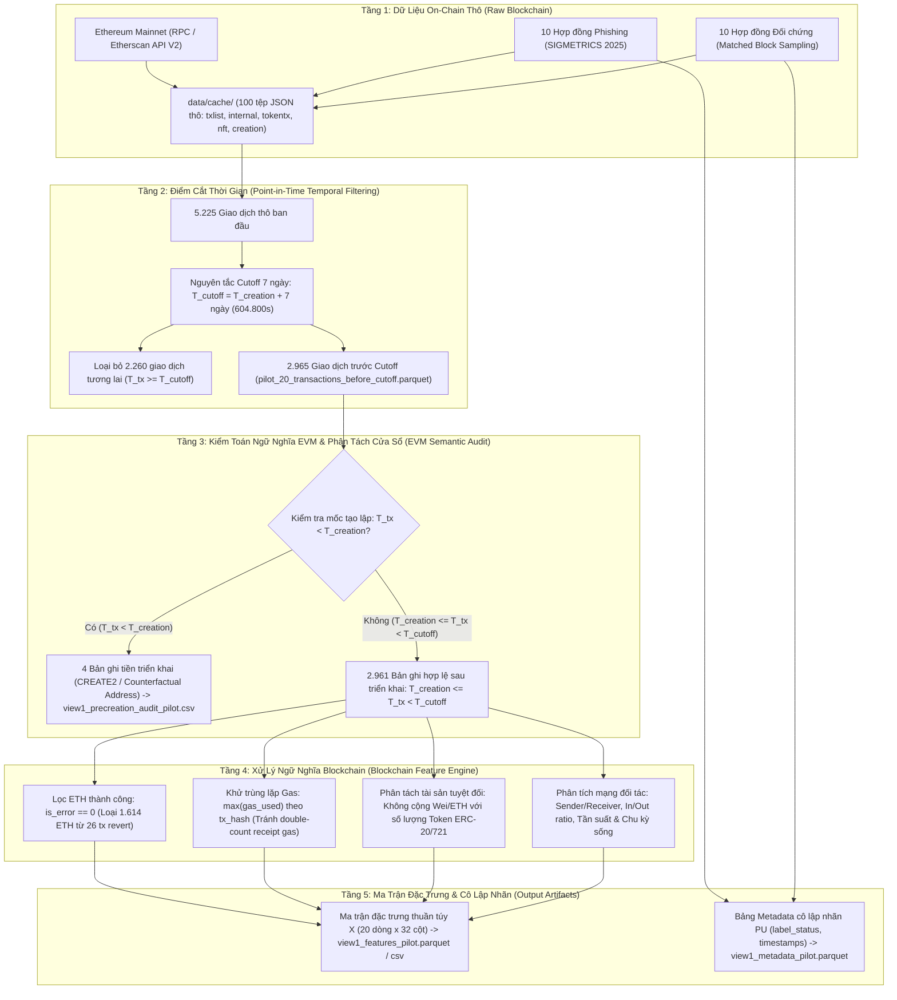
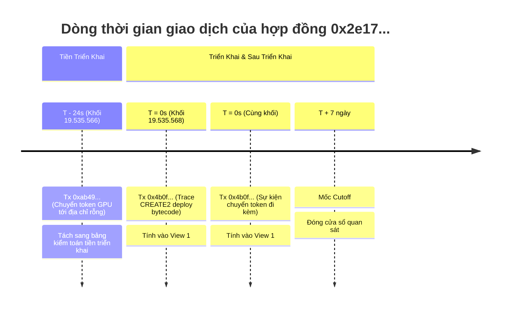
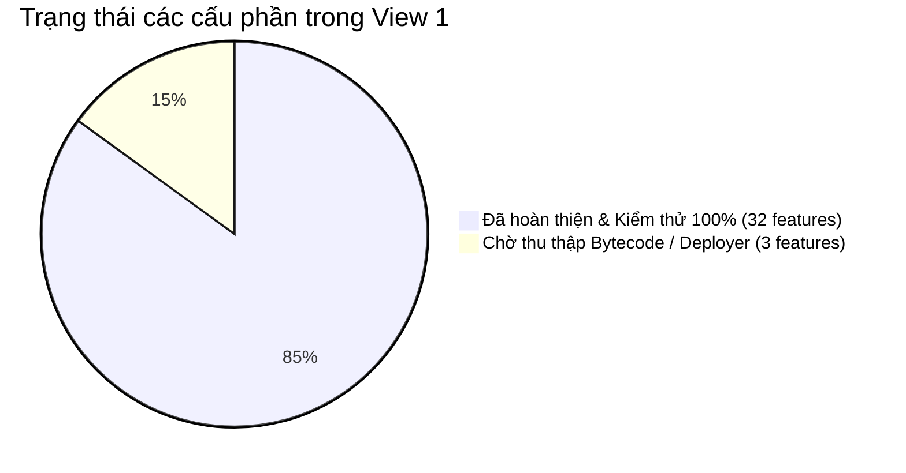

<!-- File: docs/VIEW1_PIPELINE_VI.md -->
# Hướng Dẫn Kỹ Thuật Trực Quan: Pipeline Trích Xuất View 1 (Statistical Features)

> **Tài liệu phục vụ Seminar & Báo cáo Tiến độ Khóa luận Tốt nghiệp**
> **Đề tài:** Learning Unified Graph Representations for Ethereum Phishing Detection under Incomplete Labels and Temporal Shifts
> **Phiên bản:** 1.0 (Pilot 20 Hợp Đồng Ethereum)
> **Tác giả:** Senior Blockchain Data Engineer & ML Research Engineer  
> **Sơ đồ PDF chất lượng cao:** [pipeline_view1_latest.pdf](pipeline_view1_latest.pdf)

---

## 1. Sơ Đồ Tổng Quan Pipeline Dữ Liệu (End-to-End Architecture)

Dưới đây là luồng xử lý toàn diện từ dữ liệu on-chain thô của mạng Ethereum đến ma trận đặc trưng View 1 phục vụ các mô hình Machine Learning và đồ thị Graph Neural Networks (GNN):



---

## 2. Mục Đích & Bản Chất Của Từng Bước Trong Pipeline

|   Bước   | Tên Giai Đoạn                           | Mục Đích Khoa Học & Kỹ Thuật                                                                                                                                                                                                          | Chương Trình / Module Xử Lý                             |
| :---------: | :----------------------------------------- | :------------------------------------------------------------------------------------------------------------------------------------------------------------------------------------------------------------------------------------------ | :----------------------------------------------------------- |
| **1** | **Thu thập & Caching**              | Lưu trữ nguyên bản JSON phản hồi từ 5 endpoint Etherscan V2 (`txlist`, `txlistinternal`, `tokentx`, `tokennfttx`, `getcontractcreation`). Đảm bảo khả năng tái lập 100% offline, không phụ thuộc mạng.          | `src/collect_etherscan.py`, `src/sample_unlabeled.py`    |
| **2** | **Cắt thời gian Point-in-Time**    | Triệt tiêu nguy cơ rò rỉ thông tin tương lai (Look-ahead Leakage) bằng cách loại bỏ mọi giao dịch diễn ra sau 7 ngày kể từ khi hợp đồng được triển khai ($T_{\text{tx}} \ge T_{\text{cutoff}}$).                 | `src/sample_unlabeled.py`                                  |
| **3** | **Kiểm toán tiền triển khai**    | Nhận diện các tương tác xảy ra trước khi nạp bytecode (do địa chỉ tiền định qua `CREATE2`), đưa vào bảng kiểm toán hành vi riêng và không tính vào hành vi sau triển khai.                                  | `src/build_view1.py` (`audit_pre_creation_transactions`) |
| **4** | **Chuẩn hóa ngữ nghĩa EVM**      | (1) Chỉ tính ETH từ các giao dịch thành công (`is_error == 0`) vì giao dịch lỗi bị rollback state; (2) Khử trùng lặp gas theo `tx_hash`; (3) Phân tách độc lập đơn vị tiền tệ ETH và số lượng token ERC-20. | `src/build_view1.py` (`extract_view1_features`)          |
| **5** | **Cô lập nhãn (Label Isolation)** | Tách riêng vector đặc trưng hành vi $\mathbf{X}$ khỏi thông tin nhãn (`positive`/`unlabeled`) để phục vụ học máy khách quan theo khung Positive-Unlabeled (PU) Learning.                                              | `src/build_view1.py`                                       |

---

## 3. Bản Đồ Tệp Dữ Liệu Vào / Ra (I/O Manifest)

```text
[Dữ liệu thô ban đầu]
├── data/raw/phishing_contracts.log              (37.654 địa chỉ ground truth)
└── data/cache/<address>/*.json                  (100 tệp JSON thô từ Etherscan)
                       │
                       ▼ [src/sample_unlabeled.py]
[Dữ liệu trung gian sau Cutoff]
├── data/pilot/combined/pilot_20_addresses.csv   (20 địa chỉ kèm mốc thời gian ISO)
└── data/pilot/combined/pilot_20_transactions_before_cutoff.parquet (2.965 giao dịch trước 7 ngày)
                       │
                       ▼ [src/build_view1.py]
[Dữ liệu chuẩn hóa View 1]
├── data/processed/view1/view1_features_pilot.parquet (20 dòng x 32 đặc trưng số học)
├── data/processed/view1/view1_features_pilot.csv     (Bản CSV trực quan)
├── data/processed/view1/view1_metadata_pilot.parquet (Bảng metadata cô lập nhãn)
└── data/processed/view1/view1_precreation_audit_pilot.csv (4 bản ghi tiền triển khai CREATE2)
```

---

## 4. Ví Dụ Thực Tế: Cách Tính Đặc Trưng Trên Hợp Đồng Pilot

Để giúp sinh viên và người phản biện dễ hình dung, hãy xét **Hợp đồng Positive #1 (`0x2e17626176ef839492bc292b6392d517e8434a0e`)**:

- **Thời điểm deploy:** $T_{\text{creation}} = 1.711.665.779$ (Khối 19.535.568, UTC: 2024-03-28 22:42:59).
- **Mốc Cutoff 7 ngày:** $T_{\text{cutoff}} = 1.711.665.779 + 604.800 = 1.712.270.579$.
- **Lịch sử giao dịch thu thập được:** Gồm đúng 3 bản ghi:
  1. `Tx 1` (`0xab49...`): Chuyển 388 GPU token, timestamp $1.711.665.755$ (trước deploy 24 giây).
  2. `Tx 2` (`0x4b0f...`): Lời gọi nội bộ `create2` triển khai hợp đồng, timestamp $1.711.665.779$, gas tiêu thụ trace là $493.575$ gas.
  3. `Tx 3` (`0x4b0f...`): Sự kiện chuyển token phát sinh trong cùng mã băm `0x4b0f...`, receipt `gasUsed` toàn bộ giao dịch là $616.275$ gas.



### Các bước tính toán đặc trưng cụ thể:

1. **Lọc cửa sổ hợp lệ:**
   - `Tx 1` có $T < T_{\text{creation}}$ nên bị loại khỏi cửa sổ tính toán, chuyển vào `view1_precreation_audit_pilot.csv`.
   - Cửa sổ hợp lệ còn lại đúng 2 bản ghi (`Tx 2` và `Tx 3`), đều thuộc cùng mã băm giao dịch `0x4b0f...`.
2. **Tính `total_event_count` vs `unique_tx_count`:**
   - $\text{total\_event\_count} = 2$ (gồm 1 internal trace + 1 erc20 event).
   - $\text{unique\_tx\_count} = 1$ (chỉ có duy nhất 1 transaction hash `0x4b0f...`).
3. **Tính `gas_used_total` (Khử trùng lặp Gas):**
   - Nếu cộng dồn ngây thơ (Event-level sum): $493.575 + 616.275 = 1.109.850\text{ gas}$ $\rightarrow$ **Sai (Double-counting)** vì $616.275$ là tổng gas của toàn bộ receipt đã bao gồm $493.575$ gas của lệnh create2!
   - Thuật toán chuẩn hóa (Tx-level deduplication): $\max(493.575, 616.275) = \mathbf{616.275\text{ gas}}$ $\rightarrow$ **Chính xác 100% với EVM receipt!**
4. **Tính `value_total_in_eth`:**
   - Cả 2 bản ghi đều không có chuyển ETH trực tiếp $\rightarrow \text{value\_total\_in\_eth} = \mathbf{0.0\text{ ETH}}$ (Lượng token GPU ở Tx 1 tuyệt đối không được cộng vào ETH).

---

## 5. Bảng Đầy Đủ 32 Đặc Trưng Thống Kê View 1

|     STT     | Tên Biến                      | Nhóm Hành Vi | Ý Nghĩa Chuyên Môn                       | Công Thức Toán Học                                                   | Nguồn Cột Dữ Liệu         |
| :----------: | :------------------------------ | :------------: | :------------------------------------------- | :----------------------------------------------------------------------- | :---------------------------- |
| **1** | `tx_count_total`              |     Volume     | Tổng số giao dịch thông thường         | $\sum \mathbb{I}(\text{type} = \text{'normal'})$                       | `tx_type == 'normal'`       |
| **2** | `tx_count_in`                 |   Direction   | Số sự kiện nhận tiền/token              | $\sum \mathbb{I}(\text{to} = C)$                                       | `to_address == target`      |
| **3** | `tx_count_out`                |   Direction   | Số sự kiện chuyển đi                    | $\sum \mathbb{I}(\text{from} = C)$                                     | `from_address == target`    |
| **4** | `tx_in_out_ratio`             |   Direction   | Tỷ lệ nhận / gửi                         | $\frac{\text{tx\_count\_in}}{\max(\text{tx\_count\_out}, 1)}$          | `tx_count_in, out`          |
| **5** | `normal_tx_in`                |   Direction   | Giao dịch thông thường nhận             | $\sum \mathbb{I}(\text{type} = \text{'normal'} \land \text{to} = C)$   | `tx_type, to_address`       |
| **6** | `normal_tx_out`               |   Direction   | Giao dịch thông thường gửi              | $\sum \mathbb{I}(\text{type} = \text{'normal'} \land \text{from} = C)$ | `tx_type, from_address`     |
| **7** | `internal_tx_count`           |     Volume     | Số lời gọi nội bộ                       | $\sum \mathbb{I}(\text{type} = \text{'internal'})$                     | `tx_type == 'internal'`     |
| **8** | `erc20_transfer_count`        |     Volume     | Số lượt luân chuyển token ERC-20        | $\sum \mathbb{I}(\text{type} = \text{'erc20'})$                        | `tx_type == 'erc20'`        |
| **9** | `erc721_transfer_count`       |     Volume     | Số lượt chuyển giao NFT                  | $\sum \mathbb{I}(\text{type} = \text{'erc721'})$                       | `tx_type == 'erc721'`       |
| **10** | `total_event_count`           |     Volume     | Tổng số bản ghi sự kiện on-chain        | $|\mathcal{E}(C)|$                                                     | Tổng số dòng hợp lệ      |
| **11** | `unique_tx_count`             |     Volume     | Số lượng mã băm giao dịch phân biệt  | $|\{\text{hash}(e) \mid e \in \mathcal{E}(C)\}|$                       | `COUNT(DISTINCT tx_hash)`   |
| **12** | `value_total_in_eth`          |     Value     | Tổng lượng ETH nhận thành công         | $\sum_{\text{in}, \text{is\_error}=0} \text{value\_eth}$               | `value_eth, to, is_error`   |
| **13** | `value_total_out_eth`         |     Value     | Tổng lượng ETH gửi thành công          | $\sum_{\text{out}, \text{is\_error}=0} \text{value\_eth}$              | `value_eth, from, is_error` |
| **14** | `value_net_eth`               |     Value     | Lượng ETH tích lũy ròng                 | $\text{value\_total\_in} - \text{value\_total\_out}$                   | Hiệu số 12 và 13           |
| **15** | `value_mean_in_eth`           |     Value     | Lượng ETH nhận trung bình mỗi sự kiện | $\text{mean}(\text{value\_eth})_{\text{in}, \text{is\_error}=0}$       | `value_eth`                 |
| **16** | `value_std_in_eth`            |     Value     | Độ biến động (lệch chuẩn) ETH nhận   | $\text{std}(\text{value\_eth})_{\text{in}, \text{is\_error}=0}$        | `value_eth`                 |
| **17** | `value_max_in_eth`            |     Value     | Giá trị ETH nhận lớn nhất 1 lần        | $\max(\text{value\_eth})_{\text{in}, \text{is\_error}=0}$              | `value_eth`                 |
| **18** | `unique_senders`              |    Network    | Số địa chỉ người gửi phân biệt      | $|\{s \mid \text{to}(e)=C \land s \neq C\}|$                           | `from_address`              |
| **19** | `unique_receivers`            |    Network    | Số địa chỉ người nhận phân biệt     | $|\{r \mid \text{from}(e)=C \land r \neq C\}|$                         | `to_address`                |
| **20** | `unique_counterparties_total` |    Network    | Tổng số đối tác tương tác duy nhất  | $|\text{Senders} \cup \text{Receivers}|$                               | Hợp 18 và 19                |
| **21** | `unique_counterparty_ratio`   |    Network    | Độ đa dạng của nguồn người gửi      | $\frac{\text{unique\_senders}}{\max(\text{tx\_count\_in}, 1)}$         | `unique_senders, in`        |
| **22** | `top_sender_tx_ratio`         |    Network    | Tỷ trọng người gửi lớn nhất           | $\frac{\max \text{count}(s)}{\max(\text{tx\_count\_in}, 1)}$           | Tần suất `from_address`   |
| **23** | `lifespan_seconds`            |    Temporal    | Thời gian tồn tại on-chain (giây)        | $\max(T) - \min(T)$                                                    | `timestamp_unix`            |
| **24** | `active_days`                 |    Temporal    | Số ngày có phát sinh hoạt động        | $|\{\text{date}(T)\}|$                                                 | `timestamp_unix`            |
| **25** | `active_hours`                |    Temporal    | Số giờ có phát sinh hoạt động         | $|\{\text{hour}(T)\}|$                                                 | `timestamp_unix`            |
| **26** | `tx_frequency_per_hour`       |    Temporal    | Tần suất giao dịch normal / giờ sống    | $\frac{\text{tx\_count\_total}}{\max(\text{lifespan\_hours}, 1)}$      | `tx_count_total, lifespan`  |
| **27** | `event_rate_7d`               |    Temporal    | Tần suất sự kiện chuẩn hóa / ngày     | $\frac{\text{total\_event\_count}}{7.0}$                               | `total_event_count`         |
| **28** | `gas_used_mean`               |   Execution   | Lượng gas trung bình mỗi transaction     | $\text{mean}(\max_{\text{tx\_hash}}(\text{gas\_used}))$                | `gas_used, tx_hash`         |
| **29** | `gas_used_total`              |   Execution   | Tổng lượng gas tiêu thụ thực tế       | $\sum \max_{\text{tx\_hash}}(\text{gas\_used})$                        | `gas_used, tx_hash`         |
| **30** | `error_tx_count`              |   Execution   | Số giao dịch bị lỗi (revert)             | $\sum_{\text{unique tx}} \mathbb{I}(\text{is\_error} = 1)$             | `is_error, tx_hash`         |
| **31** | `error_tx_rate`               |   Execution   | Tỷ lệ giao dịch thất bại                | $\frac{\text{error\_tx\_count}}{\max(\text{unique\_tx\_count}, 1)}$    | `error_tx_count, unique`    |
| **32** | `method_diversity`            |   Execution   | Số lượng phương thức gọi phân biệt  | $|\{\text{method\_id} \ge 10 \text{ chars}\}|$                         | `method_id`                 |

---

## 6. Giải Thích Các Khái Niệm Cốt Lõi

### 6.1 Tại sao bắt buộc phải dùng mốc Cutoff 7 ngày?

Trong phát hiện lừa đảo thực tế (Real-world Threat Detection), mô hình phải đưa ra cảnh báo **sớm** ngay khi hợp đồng vừa xuất hiện.
Nếu cho phép lấy dữ liệu qua nhiều tháng hoặc nhiều năm:

- Hợp đồng lừa đảo sẽ bị lộ các hành vi rút tiền (drain/exit scam) diễn ra ở tương lai xa.
- Xảy ra hiện tượng **Rò rỉ thông tin tương lai (Look-ahead Leakage)**: mô hình đạt độ chính xác 99% trong phòng thí nghiệm nhưng thất bại hoàn toàn khi triển khai thực tế vì trong thực tế ta không có dữ liệu của tương lai.
- Mốc $T_{\text{cutoff}} = T_{\text{creation}} + 7\text{ ngày}$ tạo ra một sân chơi đồng nhất (Fair Benchmark): mọi hợp đồng đều được quan sát đúng trong 168 giờ đầu đời.

### 6.2 Làm thế nào để tránh Double-Counting giữa Transaction và Event?

- Một transaction trên Ethereum là một nguyên tử (atomic transaction) có thể chứa:
  1. Giao dịch gốc (`normal`)
  2. Nhiều bước gọi nội bộ (`internal traces`)
  3. Nhiều sự kiện phát ra log (`events` như ERC-20 Transfer)
- **Giải pháp kỹ thuật của pipeline:**
  * **Số đếm:** Phân ranh giới rõ ràng: `unique_tx_count` đếm số `tx_hash` độc lập; `total_event_count` đếm số bản ghi.
  * **Tính Gas:** Nhóm theo `tx_hash` và lấy giá trị lớn nhất ($\max(\text{gas\_used})$) để phản ánh đúng `gasUsed` của toàn bộ giao dịch ghi nhận trong receipt, không cộng dồn các trace con.
  * **Tính ETH:** Lọc nghiêm ngặt `is_error == 0` để chỉ tính tiền đã thực sự được chuyển giao trong state chuỗi khối.

---

## 7. Trạng Thái Hoàn Thiện & Định Hướng Mở Rộng



1. **Phần đã hoàn thiện 100% (Production-Ready):**
   - Pipeline tự động trích xuất 32 đặc trưng thống kê.
   - Cơ chế lọc Point-in-Time và phân tách bảng kiểm toán tiền triển khai.
   - Bộ kiểm thử tự động 12 tiêu chí khoa học (`tests/test_view1.py`).
2. **Phần đang ở quy mô Pilot (Thử nghiệm 20 hợp đồng):**
   - Kiểm chứng tính khả thi trên 10 Positive và 10 Unlabeled đối chứng ghép cặp khối ($\pm 14$ blocks).
3. **Phần cần triển khai ở các bước tiếp theo:**
   - Mở rộng quy mô lên 400 hợp đồng (200 Positive + 200 Unlabeled).
   - Tích hợp thêm 3 đặc trưng `NOT_AVAILABLE` (`bytecode_size`, `has_selfdestruct`, `deployer_tx_count`) khi bổ sung endpoint `eth_getCode` và lịch sử ví deployer.

---

## 8. Các Giới Hạn Khoa Học & Phương Pháp Luận Cần Lưu Ý

1. **Bản chất của tập Unlabeled (PU-Learning):**
   - Không được ngộ nhận các hợp đồng Unlabeled là Benign (Lành tính). Chúng đại diện cho phân bố tự nhiên on-chain và có thể chứa cả hợp đồng lừa đảo chưa bị phát hiện.
2. **Độ trễ công bố nhãn (Publication Lag):**
   - Nhãn trong bài báo SIGMETRICS 2025 được gán sau khi chiến dịch lừa đảo đã xảy ra. Mô hình không được coi nhãn là thông tin có sẵn tại thời điểm hợp đồng ra đời.
3. **Giới hạn của dữ liệu Etherscan Free API:**
   - Etherscan API trả về thông tin vết nội bộ cơ bản (`txlistinternal`), không cung cấp cây gọi sâu (Full Call Trace Tree) hay State Diff chi tiết như các node chuyên dụng (Geth debug trace / Alchemy Trace API).
