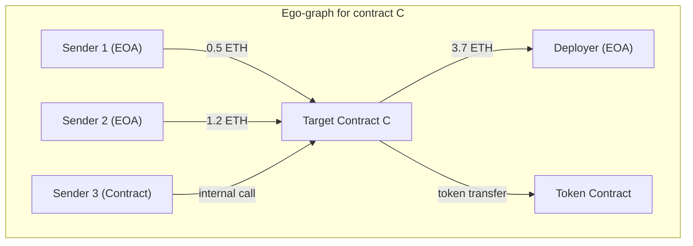

# Three Views Specification — Point-in-Time Ethereum Phishing Dataset

> **Temporal invariant (applies to ALL views):**
> Only transactions with `block_timestamp < feature_cutoff_at` are used.
> No future information leaks into any view.

---

## View 1: Statistical Features (Address-Level Aggregates)

### Purpose

Tabular feature vector per address. Suitable for classical ML (XGBoost, LightGBM, logistic regression) and as node features in View 3.

### Temporal constraint

```
SELECT * FROM transactions
WHERE block_timestamp < feature_cutoff_at
  AND (from_address = target OR to_address = target)
```

### Feature table

| #  | Feature name                  | Type  | Description                            | Computation                             |
| -- | ----------------------------- | ----- | -------------------------------------- | --------------------------------------- |
| 1  | `tx_count_total`            | int   | Total normal transactions              | COUNT(normal_txs)                       |
| 2  | `tx_count_in`               | int   | Incoming transactions                  | COUNT(WHERE to = target)                |
| 3  | `tx_count_out`              | int   | Outgoing transactions                  | COUNT(WHERE from = target)              |
| 4  | `tx_in_out_ratio`           | float | Ratio of in/out                        | tx_count_in / max(tx_count_out, 1)      |
| 5  | `value_total_in_eth`        | float | Total ETH received                     | SUM(value WHERE to = target)            |
| 6  | `value_total_out_eth`       | float | Total ETH sent                         | SUM(value WHERE from = target)          |
| 7  | `value_net_eth`             | float | Net ETH balance change                 | in - out                                |
| 8  | `value_mean_in`             | float | Mean incoming value                    | MEAN(value WHERE to = target)           |
| 9  | `value_std_in`              | float | Std dev of incoming values             | STD(value WHERE to = target)            |
| 10 | `value_max_in`              | float | Max single incoming value              | MAX(value WHERE to = target)            |
| 11 | `unique_senders`            | int   | Unique addresses sending to target     | COUNT(DISTINCT from WHERE to = target)  |
| 12 | `unique_receivers`          | int   | Unique addresses receiving from target | COUNT(DISTINCT to WHERE from = target)  |
| 13 | `unique_counterparty_ratio` | float | Diversity of counterparties            | unique_senders / max(tx_count_in, 1)    |
| 14 | `internal_tx_count`         | int   | Internal (contract call) transactions  | COUNT(internal_txs)                     |
| 15 | `erc20_transfer_count`      | int   | ERC-20 token transfers                 | COUNT(erc20_txs)                        |
| 16 | `erc721_transfer_count`     | int   | NFT transfers                          | COUNT(erc721_txs)                       |
| 17 | `gas_used_mean`             | float | Average gas consumed                   | MEAN(gas_used)                          |
| 18 | `gas_used_total`            | float | Total gas consumed                     | SUM(gas_used)                           |
| 19 | `lifespan_seconds`          | int   | Time from first to last tx             | MAX(timestamp) - MIN(timestamp)         |
| 20 | `tx_frequency`              | float | Transactions per hour of lifespan      | tx_count_total / max(lifespan_hours, 1) |
| 21 | `error_tx_rate`             | float | Fraction of failed transactions        | COUNT(is_error=1) / tx_count_total      |
| 22 | `method_diversity`          | int   | Unique method IDs called               | COUNT(DISTINCT method_id)               |
| 23 | `bytecode_size`             | int   | Contract bytecode length               | len(eth_getCode(address))               |
| 24 | `has_selfdestruct`          | bool  | Contract has SELFDESTRUCT opcode       | 0xFF in bytecode                        |
| 25 | `deployer_tx_count`         | int   | Creator's total tx count at cutoff     | COUNT(deployer's txs before cutoff)     |

### Output format

```
data/pilot/view1_features.parquet
```

Schema: `(address: str, label_status: str, f1..f25: numeric)`

### Implementation notes

- All monetary values converted from wei to ETH (÷ 10^18)
- Handle division-by-zero with `max(denominator, 1)`
- Contracts with 0 transactions before cutoff get all-zero features (not dropped)

---

## View 2: Sequence Features (Temporal Transaction Chains)

### Purpose

Ordered sequence of transaction events per address. Suitable for LSTM, Transformer, or temporal convolution models.

### Temporal constraint

Same as View 1 — only pre-cutoff transactions.

### Sequence element definition

Each transaction becomes one element in the sequence:

| Field                 | Type          | Description                                              |
| --------------------- | ------------- | -------------------------------------------------------- |
| `direction`         | int           | 0 = incoming (to = target), 1 = outgoing (from = target) |
| `value_eth`         | float         | Transaction value in ETH                                 |
| `gas_used`          | int           | Gas consumed                                             |
| `time_delta_sec`    | int           | Seconds since previous transaction (0 for first)         |
| `counterparty_type` | int           | 0 = EOA, 1 = contract                                    |
| `method_id`         | str (4 bytes) | First 4 bytes of input data                              |
| `is_error`          | int           | 0 or 1                                                   |
| `is_internal`       | int           | 0 = normal, 1 = internal tx                              |
| `block_position`    | int           | Transaction index within block                           |

### Sequence construction

```python
def build_sequence(address, txs, cutoff):
    # Filter and sort
    relevant = [tx for tx in txs if tx.timestamp < cutoff]
    relevant.sort(key=lambda t: (t.block_number, t.tx_index))
  
    seq = []
    prev_time = relevant[0].timestamp if relevant else 0
    for tx in relevant:
        element = {
            'direction': 0 if tx.to == address else 1,
            'value_eth': tx.value / 1e18,
            'gas_used': tx.gas_used,
            'time_delta_sec': tx.timestamp - prev_time,
            'counterparty_type': get_type(counterparty(tx, address)),
            'method_id': tx.input[:10] if tx.input else '0x',
            'is_error': tx.is_error,
            'is_internal': 0,
            'block_position': tx.tx_index,
        }
        seq.append(element)
        prev_time = tx.timestamp
    return seq
```

### Padding & truncation

- **Max length:** 500 transactions (configurable)
- **Padding:** Left-pad with zeros for shorter sequences
- **Truncation:** Keep the **last** N transactions (most recent before cutoff)

### Output format

```
data/pilot/view2_sequences.parquet
```

Schema: `(address: str, label_status: str, sequence: list[dict], seq_length: int)`

---

## View 3: Ego-Graph (1-Hop Transaction Graph)

### Purpose

Local graph structure centered on each target address. Suitable for GNN (GraphSAGE, GAT, GIN) or manual graph feature extraction.

### Temporal constraint

Only edges (transactions) with `block_timestamp < feature_cutoff_at`.

### Graph construction



### Node definition

Each node in the ego-graph:

| Field                      | Type | Description                                  |
| -------------------------- | ---- | -------------------------------------------- |
| `address`                | str  | Ethereum address                             |
| `node_type`              | int  | 0 = target, 1 = EOA, 2 = contract            |
| `is_labeled`             | bool | Whether address is in phishing_contracts.log |
| `tx_count_before_cutoff` | int  | This node's total transactions before cutoff |
| `first_seen`             | int  | Earliest timestamp of this node              |

### Edge definition

Each edge represents aggregated transactions between two addresses:

| Field                 | Type  | Description                                  |
| --------------------- | ----- | -------------------------------------------- |
| `src`               | str   | Sender address                               |
| `dst`               | str   | Receiver address                             |
| `tx_count`          | int   | Number of transactions from src → dst       |
| `total_value_eth`   | float | Sum of ETH transferred                       |
| `first_tx_time`     | int   | Earliest transaction timestamp               |
| `last_tx_time`      | int   | Latest transaction timestamp (before cutoff) |
| `mean_value_eth`    | float | Average transaction value                    |
| `includes_internal` | bool  | Whether any internal txs exist               |
| `includes_token`    | bool  | Whether any ERC-20/721 transfers exist       |

### Graph scope

- **Depth:** 1-hop only (direct counterparties of target)
- **Maximum neighbors:** Cap at 100 nodes per ego-graph (sample if more)
- **Edge aggregation:** Multiple transactions between same pair → single edge with aggregated features

### Output format

```
data/pilot/view3_graphs/
├── node_features.parquet    # All nodes across all ego-graphs
├── edge_list.parquet        # All edges with features
└── graph_mapping.parquet    # Maps each node/edge to its ego-graph ID
```

### Alternative: PyG format

```python
# For PyTorch Geometric
from torch_geometric.data import Data

graph = Data(
    x=node_feature_tensor,       # [num_nodes, node_feat_dim]
    edge_index=edge_index_tensor, # [2, num_edges]
    edge_attr=edge_feat_tensor,   # [num_edges, edge_feat_dim]
    y=label_tensor,               # 0 or 1 for target node
)
```

---

## Cross-View Consistency Rules

| Rule                                    | Description                                                                             |
| --------------------------------------- | --------------------------------------------------------------------------------------- |
| **Same cutoff**                   | All three views for the same address use identical `feature_cutoff_at`                |
| **Same address set**              | All three views cover exactly the same set of addresses                                 |
| **Temporal ceiling**              | No transaction after cutoff appears in any view                                         |
| **Label isolation**               | `label_status` is metadata, not a feature; never included in X                        |
| **View 1 ⊂ View 2**              | Statistical features are derivable from sequence data (but pre-computed for efficiency) |
| **View 1 = View 3 node features** | The target node's features in View 3 are exactly the View 1 features                    |

---

## Prerequisite: Setting `feature_cutoff_at`

Since `label_observed_at` is unknown (not in the released dataset), we use a conservative proxy:

```
feature_cutoff_at = min(
    contract_creation_timestamp + 30 days,   # Allow 30 days of activity
    2024-12-01T00:00:00Z                     # 1 month before dataset end
)
```

> [!WARNING]
> This is a **heuristic** because we don't know when each address was actually flagged as phishing. The 30-day window and Dec 2024 cap are conservative choices to:
>
> 1. Ensure sufficient transaction data for features
> 2. Avoid using data from after the study period
> 3. Leave a buffer before the dataset's end date (Jan 1, 2025)

---

## Conditions to Begin View 1

✅ All of the following must be true before implementing View 1:

| # | Condition                                                        | Status     |
| - | ---------------------------------------------------------------- | ---------- |
| 1 | Pilot sample of 200 positive + 200 unlabeled addresses generated | ⬜ Pending |
| 2 | Contract creation timestamps recovered for ≥95% of pilot        | ⬜ Pending |
| 3 | Transaction histories downloaded for pilot addresses             | ⬜ Pending |
| 4 | `feature_cutoff_at` computed for each address                  | ⬜ Pending |
| 5 | `label_schema.csv` populated with real timestamps              | ⬜ Pending |
| 6 | Data quality checks passed (see `data_collection_plan.md`)     | ⬜ Pending |
| 7 | At least 1 address manually verified on Etherscan                | ⬜ Pending |
