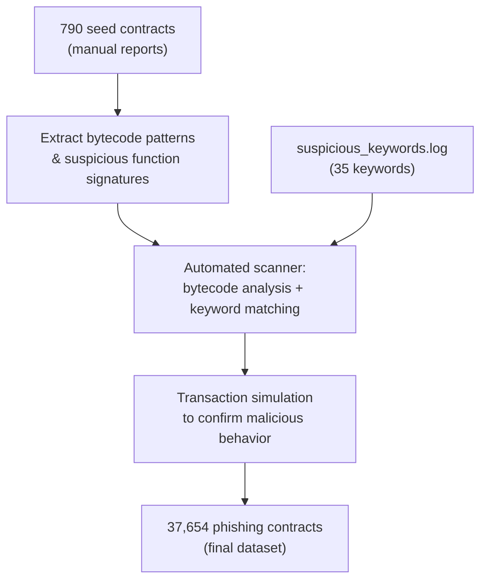
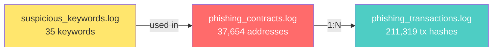

# Dataset Audit — phishing_contract_sigmetrics25

> **Paper:** "Phishing Tactics Are Evolving: An Empirical Study of Phishing Contracts on Ethereum"
> **Venue:** ACM SIGMETRICS 2025 (POMACS Vol. 9, No. 2, pp. 1–24)
> **DOI:** [10.1145/3727138](https://doi.org/10.1145/3727138)
> **Authors:** Bowen He, Xiaohui Hu, Yufeng Hu, Ting Yu, Rui Chang, Lei Wu, Yajin Zhou
> **Repository:** [blocksecteam/phishing_contract_sigmetrics25](https://github.com/blocksecteam/phishing_contract_sigmetrics25)
> **Audit date:** 2026-10-14

---

## 1. File Inventory

| # | File | Size | Lines | Format | Content |
|---|------|------|-------|--------|---------|
| 1 | [phishing_contracts.log](file:///d:/KHÓA%20LUẬN/phishing_contract_sigmetrics25/data/raw/phishing_contracts.log) | 1,656,774 B (~1.58 MB) | 37,654 | One Ethereum address per line | Contract addresses identified as phishing |
| 2 | [phishing_transactions.log](file:///d:/KHÓA%20LUẬN/phishing_contract_sigmetrics25/data/raw/phishing_transactions.log) | 14,369,692 B (~13.7 MB) | 211,319 (+ 1 trailing empty) | One transaction hash per line | Transactions involving phishing contracts |
| 3 | [suspicious_keywords.log](file:///d:/KHÓA%20LUẬN/phishing_contract_sigmetrics25/data/raw/suspicious_keywords.log) | 282 B | 35 non-empty (+1 trailing) | One keyword per line, lowercase | Keywords used in phishing function names |

---

## 2. Detailed Format Analysis

### 2.1 phishing_contracts.log

- **Format:** Plain text, one Ethereum address per line
- **Address format:** `0x` + 40 hex characters = 42 characters total
- **Casing:** All **lowercase** (no EIP-55 checksum encoding)
- **Sorting:** Lexicographically sorted ascending
- **Total records:** 37,654
- **Unique records:** 37,654 (✅ zero duplicates)
- **Empty lines:** 0
- **Encoding:** UTF-8 with CRLF line endings
- **Sample (first 5):**
  ```
  0x000000000000232e765d898b5f1b189b5c993f05
  0x0000000000958ec6667eb97e2f64f6909073e6b7
  0x0000000000d4f82814c07974ee1c0ea4b7632c7e
  0x00000002a90b740bd0d3b24277ca2c6236b11316
  0x00000004c4ac9089e5a34c5c4dd1adc3b2304248
  ```

> [!NOTE]
> Many addresses have long runs of leading zeros (e.g., `0x000000...`). These are likely CREATE2-deployed contracts with vanity prefixes — a pattern noted by the paper for phishing contracts mimicking legitimate protocol addresses.

### 2.2 phishing_transactions.log

- **Format:** Plain text, one transaction hash per line
- **Hash format:** `0x` + 64 hex characters = 66 characters total (standard Ethereum tx hash)
- **Casing:** All lowercase
- **Sorting:** Not lexicographically sorted (likely ordered by discovery or block number)
- **Total records:** 211,319
- **Unique records:** 211,319 (✅ zero duplicates)
- **Empty lines:** 1 (trailing newline on last line)
- **Average transactions per contract:** 211,319 / 37,654 ≈ **5.61 tx/contract**

> [!IMPORTANT]
> No mapping between transactions and contracts is provided. To link them, each tx hash must be looked up on-chain via `eth_getTransactionReceipt` to identify the contract address involved.

### 2.3 suspicious_keywords.log

- **Format:** Plain text, one keyword per line, all lowercase
- **Total keywords:** 35
- **Unique keywords:** 35 (✅ zero duplicates)
- **Categories observed:**
  - **Airdrop/reward lure:** `airdrop`, `claim`, `reward`, `gift`, `giveaway`, `bonus`, `free`, `promotion`
  - **DeFi mimicry:** `swap`, `exchange`, `stake`, `trading`, `mining`, `earn`, `profit`
  - **Security pretexts:** `securityupdate`, `verify`, `confirm`, `auth`, `safeguard`, `secure`
  - **Action verbs:** `enable`, `start`, `connect`, `mint`, `unlock`, `withdraw`, `deposit`
  - **Token/asset terms:** `crypto`, `token`, `nft`, `eth`, `smart`
  - **Legitimacy signals:** `official`, `offer`

---

## 3. Temporal Information Audit

> [!CAUTION]
> **No timestamps are present in any of the three files.** This is the most critical gap for building a Point-in-Time dataset.

| Temporal attribute | Available in files? | Recoverable? |
|--------------------|:-------------------:|--------------|
| Contract creation time | ❌ | ✅ Via `eth_getTransactionReceipt` of contract creation tx |
| Transaction timestamp | ❌ | ✅ Via block number → `eth_getBlockByNumber` |
| First phishing activity | ❌ | ⚠️ Partially, from earliest tx in the dataset per contract |
| Label assignment date | ❌ | ❌ Not recorded; paper says data covers 2022-12-29 to 2025-01-01 |
| Label confirmation date | ❌ | ❌ Unknown when each address was first flagged |

### What the paper tells us about time range

Per the paper and web search results:
- **Dataset period:** Dec 29, 2022 → Jan 1, 2025 (approximately 2 years)
- **Initial seed:** 790 reported phishing contracts (from existing reports/manual analysis)
- **Expansion:** Automated framework using bytecode analysis + transaction simulation found the remaining ~36,864 contracts

---

## 4. Labeling Methodology Assessment

### 4.1 How labels were created (from paper description)



### 4.2 Label categories

| Category | Count | Method | Confidence |
|----------|-------|--------|------------|
| Seed contracts | ~790 | Manual reports (BlockSec, community reports) | High — human-verified |
| Expanded set | ~36,864 | Automated: bytecode + keyword + tx simulation | Medium-High — algorithmic with simulation validation |

### 4.3 Critical observations for thesis use

> [!WARNING]
> **Label provenance is opaque.** The released dataset does NOT distinguish:
> 1. Which of the 37,654 addresses came from the manual seed vs. automated expansion
> 2. When each address was first flagged as phishing
> 3. Whether any labels were later revoked or disputed
>
> This means we **cannot** construct a true `label_observed_at` timestamp, which is essential for avoiding temporal leakage in a Point-in-Time framework.

---

## 5. Cross-file Relationship



- **No explicit join key** exists between contracts and transactions
- The keywords were used as part of the detection pipeline, not as per-contract metadata
- To associate transactions with specific contracts: must query on-chain data

---

## 6. Data Quality Summary

| Check | Result | Details |
|-------|--------|---------|
| Format consistency | ✅ Pass | All addresses 42 chars, all hashes 66 chars |
| Uniqueness | ✅ Pass | Zero duplicates in both files |
| Completeness | ⚠️ Partial | No timestamps, no contract-tx mapping, no label provenance |
| Checksumming | ℹ️ None | All lowercase — need to apply EIP-55 for use with some tools |
| Paper consistency | ✅ Pass | 37,654 contracts matches the paper's stated count |
| Time range | ⚠️ Unverifiable | Paper claims Dec 2022 – Jan 2025, but no timestamps in data |

---

## 7. Risks & Mitigations for Thesis

| Risk | Severity | Mitigation |
|------|----------|------------|
| Temporal leakage (using future info) | 🔴 Critical | Must recover on-chain timestamps; use conservative cutoffs |
| False positive labels (automated detection) | 🟡 Medium | Treat as "positive" with caveat; can spot-check via Etherscan |
| Missing negative class | 🟡 Medium | Never treat unlabeled as benign; use PU-learning framework |
| No label time → can't split chronologically by label event | 🔴 Critical | Use contract creation time as proxy; acknowledge limitation |
| API rate limits for on-chain data recovery | 🟡 Medium | Start with pilot of 100–300 contracts before scaling |

---

## 8. Verified Facts (ground truth)

1. **37,654** phishing contract addresses — confirmed unique, lowercase hex, sorted
2. **211,319** related transaction hashes — confirmed unique, standard 66-char format
3. **35** suspicious keywords used in the detection pipeline
4. **Zero** temporal metadata in any released file
5. **Zero** explicit contract ↔ transaction mapping
6. Paper claims time range: **2022-12-29 to 2025-01-01**
7. Initial seed: **~790** manually reported contracts
8. Expansion: automated bytecode + keyword + transaction simulation
